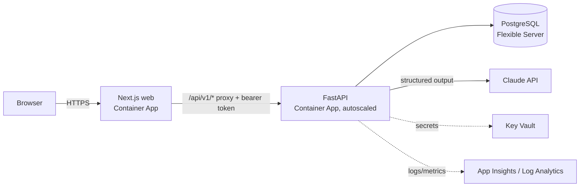

# Architecture

## 1. Responsibilities

| Component | Responsibility |
| --- | --- |
| `src/app/page.tsx` | Public landing page: what the tool does (no invented figures). |
| `src/app/login`, `src/app/api/auth/*` | Sign-in. The JWT is stored in an httpOnly, SameSite=Lax cookie; works before hydration. |
| `src/app/api/v1/[...path]` | Same-origin proxy to the API. Attaches the bearer token, validates the path (no traversal), caps body size. |
| `src/app/app/page.tsx` | Client workspace (server-rendered with the client's network and baseline plan). |
| `src/components/*` | Control tower map, dispatch board, itinerary planner, risk & fallback, savings tables. |
| `backend/app/engine` | Pure, tested computation: network model, routing, planner, risk model, Monte Carlo, impact. No I/O. |
| `backend/app/intel` | Alert analysis: Claude with a network-pinned JSON schema; rule-based fallback. |
| `backend/app/api` | HTTP layer: auth, tenant scoping, validation, serialisation. |
| `backend/app/db` | SQLAlchemy models, idempotent seed, migrations under a Postgres advisory lock. |

## 2. Network model

- Nodes: suppliers (`hub`), delivery points (`community`), junctions, and river ports.
- Corridors: road legs (OSRM geometry and distance on OpenStreetMap), river legs (Overpass waterway geometry, downstream/upstream speeds), and port transfers (handling cost and time).
- Each corridor becomes two directed arcs with per-tonne weights: cost (USD/t) from published unit rates and time (h) from speed estimates.
- A built network is cached per (client, network version) in each API process.

## 3. Routing and planning

| Question | Algorithm |
| --- | --- |
| Best route A → B | Bidirectional A* with balanced potentials. The heuristic is `k × great-circle km`, where `k` is the largest constant with `weight ≥ k × straight-line km` on every arc, so it is consistent for the objective and for any delays or surcharges. |
| Which supplier is cheapest to reach B | One reverse Dijkstra from B prices every supplier at once. |
| Has the cut split the network? | Union-find over open corridors (connected components). |
| Candidate Plan B routes | Yen's k-shortest loopless paths per supplier. |

For a delivery the planner ranks: the planned route, a detour from the same supplier, a switch to another supplier, and air delivery from the nearest airstrip. The cheapest option wins (or the fastest, with `objective=time`). Communities are processed in client priority order. Suppliers are treated as unconstrained, as the client requested.

## 4. Correlated disruption model

1. **Issues co-occur.** Each issue occurs with probability *p* (from its qualitative likelihood band). Occurrences are drawn jointly with a Gaussian copula whose correlations reflect which kinds come together (flood + landslide, conflict + checkpoints) and whether footprints overlap.
2. **Corridors fail together.** Within an issue's footprint, a one-factor copula with kind-specific correlation applies: floods hit neighbouring tracks together (ρ = 0.85), accidents are independent (ρ = 0).
3. **Consequences differ.** A corridor closes, is delayed, or costs more, depending on issue kind × surface. A flood closes dirt tracks far more often than paved roads and never closes the river. A fuel shortage closes nothing but raises cost.

The Monte Carlo re-plans every sampled future. Futures with identical network states are solved once, which keeps 20,000 runs around two seconds. It reports outcome shares per delivery, cost and time distributions, frequent fallbacks, a robust Plan B (P(open) and expected cost, airlift if cut) and an incremental playbook (what each issue changes).

## 5. Alert analysis

Claude (`claude-opus-5-5`) receives the network (IDs, names, planned deliveries) and the alerts, with alerts delimited as untrusted data. It returns ranked issues through structured output. The JSON schema pins corridor, node and alert IDs to enums from the client's network. Likelihood is qualitative; the probability used in simulation comes from an explicit band table. Refusals, truncation, API errors, timeouts and missing keys all fall back to the rule-based analyser, and the response says which engine ran. Server-side refusal fallbacks are enabled (`fallbacks: "default"`).

## 6. Data and security

- Multi-tenant: every row carries `tenant_id`; every query is scoped by the signed-in user's tenant. A test checks cross-tenant access.
- Passwords are hashed with Argon2; JWT is HS256 with issuer and expiry; rate limits apply to sign-in and analysis.
- Secrets (DB URL, JWT secret, demo password, LLM key) live in Key Vault and are read by Container Apps via a managed identity. There are no registry passwords; images are pulled with AcrPull.
- Migrations run on start-up under a Postgres advisory lock, so several replicas can start at once.

## 7. Night theme and accessibility

The workspace declares `color-scheme: dark` and has no theme toggle. Surfaces are graphite panels over a dark hillshaded basemap; the map is the only saturated element. Colour is reserved for meaning: route green for selected routes and on-plan deliveries, river blue for barge legs, amber for supplier changes and coral for unreachable destinations or closed corridors. Text set in a status colour uses a lighter step that clears 4.5:1 on the panel surface, and the four status colours were checked for colour-vision separation with the data-viz palette validator.

## 8. Scaling

- The API is stateless apart from the per-process planner cache, so it scales horizontally (Container Apps HTTP rule, 1–5 replicas by default).
- Simulation is CPU-bound and memoised. For networks with tens of thousands of edges, swap point-to-point routing for contraction hierarchies (e.g. OSRM) and move large simulations to a queue-backed worker (Container Apps jobs). The engine interfaces do not change.
- The database stores configuration, alerts, analyses and runs, not routing state.
