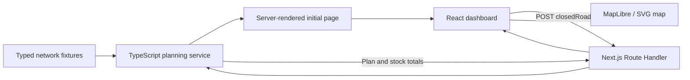

# Application architecture

## 1. Runtime

ViaMensa runs as one Next.js application. Next.js renders the initial plan on the server, serves the React interface and exposes the JSON API. A second server is not required.

## 2. Responsibilities

| Module | Responsibility |
| --- | --- |
| `src/app/page.tsx` | Supplies the network and baseline plan for the first render. |
| `src/app/api/` | Handles HTTP, JSON parsing, request limits and response codes. |
| `src/lib/server/planning.ts` | Validates corridor IDs and calculates routes and allocations. No browser dependencies. |
| `src/lib/data/network.ts` | Defines the illustrative input model. |
| `src/lib/types.ts` | Shares domain and response types between client and server. |
| `src/components/dashboard.tsx` | Owns the applied scenario, selected destination and loading/error state. |
| `src/components/map/` | Renders the same plan geographically or as an interactive schematic. |
| `src/app/globals.css` | Defines the light theme, component styles and responsive layout. |

## 3. Data model and units

Nodes are a union of hubs, communities and junctions. Hubs have stock. Communities define demand, population, planned supplier, IPC phase and days of food remaining. Corridors are bidirectional links with travel time and an illustrative disruption probability.

- Coordinates: `[longitude, latitude]` in decimal degrees.
- Food and inventory: metric tonnes.
- Travel: hours.
- Exposure: probability from 0 to 1 for an illustrative 72-hour period.
- Food remaining: days.
- People: integer counts in the synthetic model.

## 4. Planning policy

1. Sort communities by descending IPC phase, ascending days of food remaining, then ID for a stable tie-break.
2. Run Dijkstra's shortest-path algorithm from each community over open corridors, using travel hours as weights.
3. Keep the planned supplier when it is reachable and has enough stock for the full demand.
4. Otherwise choose the reachable, sufficiently stocked hub with the shortest travel time. Break equal times by hub ID.
5. Deduct the full allocation before considering the next community. Never allocate negative stock.
6. Mark a destination unserved if no reachable hub can provide its whole allocation. This version does not split a delivery across hubs or make partial allocations.
7. Compare with the all-open baseline to classify the result.

| Status | Meaning |
| --- | --- |
| `on-plan` | Planned supplier and baseline path remain available. |
| `rerouted` | Planned supplier serves the destination through a different path. |
| `supplier-changed` | A different hub serves the destination. |
| `unreachable` | No reachable hub has sufficient stock for the full allocation, due to connectivity or stock shortage. |

This is a priority allocation heuristic. It does not minimise total system travel time, account for fleet capacities or solve a vehicle routing problem. Exposure values are descriptive inputs and do not automatically close roads.

## 5. Client state and mapping

The initial page contains a server-calculated plan. Scenario changes call `POST /api/plan`. State is updated only after a successful response. Failed requests retain the previous plan and show a message. Superseded requests are aborted so stale responses cannot overwrite newer choices.

The frontend enriches the plan with cached road and river geometry without changing its routing decisions. Truck and barge animation follows those paths using a shared playback clock and illustrative corridor durations. Reduced motion preferences disable automatic movement. The map releases animation frames, markers, its resize observer and WebGL resources when unmounted.

MapLibre is installed through npm. Its worker URL is declared explicitly so Next.js emits a matching hashed worker asset. `map/basemap.ts` uses the complete OpenFreeMap Positron vector style with map attribution; no API key is required. An SVG view using the same cached paths is available when the map cannot initialise. The corridor table provides closure controls through keyboard-accessible buttons. Optional terrain and hypothetical risk footprints are display layers.

The risk forecast and fallback playbook are browser-only features. They add no API endpoint and do not modify the planning service. See [Frontend design and mapping](FRONTEND.md) for the simulation assumptions and geographic sources.

## 6. Night theme and accessibility

The app declares `color-scheme: dark` and has no theme toggle. Surfaces are graphite panels over a dark hillshaded basemap; the map is the only saturated element. Colour is reserved for meaning: route green for selected routes and on-plan deliveries, river blue for barge legs, amber for supplier changes and coral for unreachable destinations or closed corridors. Text set in a status colour uses a lighter step that clears 4.5:1 on the panel surface, and the four status colours were checked for colour-vision separation with the data-viz palette validator.

Statuses include text and icons. Visible focus states, a skip link, labeled controls, announced recalculation results, reduced motion support and a corridor table complement the canvas map.

## 7. Persistence and deployment

The API is stateless. Fixture data is read-only and every calculation starts from the defined inventory. Scenarios reset on refresh. Deploy to a Node-compatible Next.js host; a static HTML export would omit the API.

To add persistence, introduce a repository layer between API and planner, store versioned networks/scenarios, and keep the pure planner as a tested calculation module. Authentication, access control and live data ingestion can be added with that integration.

## 8. Verification

`npm run check` runs lint, type checking and tests. Tests cover path continuity, closed-road exclusion, inventory conservation, scarce stock and priority, isolation, deterministic results and API errors. `npm run build` verifies the production application.
